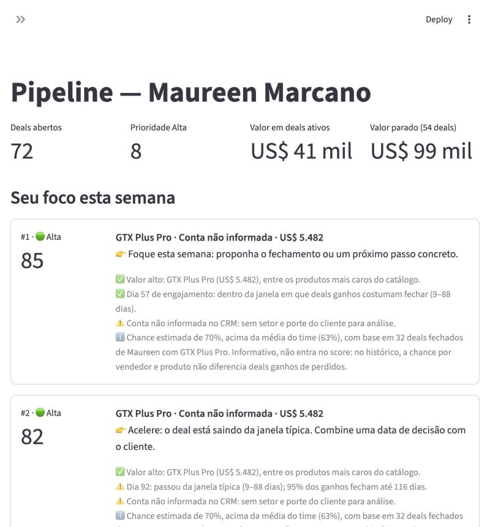
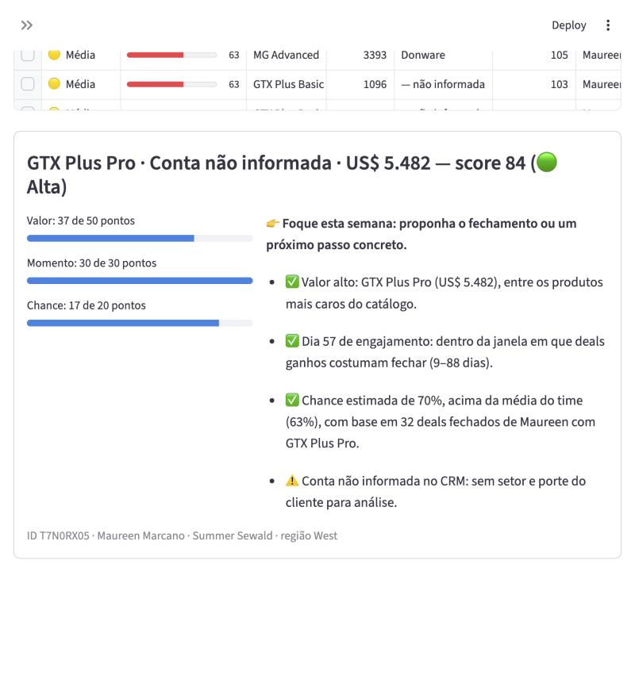

# Submissão — Lucas Siqueira — Challenge 003

## Sobre mim

- **Nome:** Lucas Siqueira
- **LinkedIn:** [URL]
- **Challenge escolhido:** 003 — Lead Scorer (Vendas / RevOps)

---

## Executive Summary

Construí um app em Streamlit em que o vendedor escolhe o próprio nome e vê o pipeline em ordem de prioridade. Cada deal traz a próxima ação e os motivos da posição. Antes de construir qualquer score, testei os dados: **nenhum atributo do CRM prevê se um deal será ganho**. Vendedor, produto, setor, porte e tempo no pipeline acertam tanto quanto o acaso (AUC 0,47–0,52 em teste temporal). Por isso o app não finge prever: ordena por **valor** (60 pontos) e **momento** (40 pontos), e mostra a chance histórica só como informação. A descoberta de maior impacto é que **81% dos deals em Engaging (1.291) estão parados há mais tempo do que qualquer deal já levou para fechar**. A primeira recomendação para a Head de RevOps é limpar esse pipeline, e o app separa esses deals numa fila própria.

---

## Solução

**Como rodar** (Python 3.11+; testado em 3.11 e 3.14):

```bash
cd solution
pip install -r requirements.txt
streamlit run app.py
```

Os dados (CSVs do Kaggle, licença CC0) já estão em `solution/data/`. Detalhes de setup, lógica e limitações estão em [`solution/README.md`](solution/README.md).

| Pasta | Conteúdo |
|---|---|
| [`solution/`](solution/) | App, motor de scoring, pipeline de dados, 41 testes |
| [`docs/`](docs/) | Requisitos, arquitetura, plano, análise de dados, dicionário de dados e auditoria de qualidade (doc 08) |
| [`process-log/`](process-log/) | Evidências do uso de IA: narrativa, scripts, screenshots, export da conversa |

### Abordagem

1. **Discovery antes de código** ([docs 01–03](docs/)). Li o README do desafio e os critérios, baixei o dataset e rodei a análise exploratória antes de decidir qualquer coisa. Cada afirmação dos documentos foi marcada como fato (medido no dado) ou hipótese.
2. **Primeiro, perguntar se dá para prever.** Testei cada variável em holdout temporal (treino até set/2017, teste em out–dez) e em snapshots mensais, reconstruindo o pipeline aberto em cada data. Nada passou do acaso. Isso mudou o produto: em vez de um "modelo de probabilidade", uma **regra de priorização honesta**.
3. **Faixas antes do score.** Com 81% do Engaging parado, um score único jogaria quase tudo para o fundo da lista. A faixa vem primeiro (Alta, Média, Qualificar, Baixa, Requalificar) e o score ordena dentro dela.
4. **Validação com o passado e ajuste dos pesos.** O desenho inicial era 50/30/20 (Valor/Momento/Chance). O backtest mostrou que a chance só somava ruído. Revisei o desenho, comparei 9 combinações e adotei **60/40/0**, que superou o original em 8 de 9 meses.
5. **Camada de dados auditável.** Um pipeline separado valida chaves, reconcilia contagens, registra cada problema de qualidade e declara quais colunas são desfecho, para que nunca virem preditoras.

### Resultados / Findings

**O app:**

| Seu foco esta semana | Por que este deal tem esse score |
|---|---|
|  |  |

- Visões por vendedor, manager, região e time todo. As visões de gestão incluem o resumo por vendedor (abertos, Alta, parados, valor parado).
- Cada deal traz score, faixa, ação recomendada e de 3 a 4 motivos em português, com número, unidade e comparação. Exemplo: "Dia 57 de engajamento: dentro da janela em que deals ganhos costumam fechar (9–88 dias)."
- A aba **Como o score funciona** mostra a regra, o gráfico de ciclo e o resultado da validação, inclusive o que o score *não* consegue fazer.

**Validação** (9 snapshots mensais de 2017; só usa o que se sabia em cada data):

| Ordenação | Valor ganho nos top 20% da lista |
|---|---|
| Score 60/40/0 | **48%** |
| Score 50/30/20 (versão inicial) | 46% |
| Só valor | 49% |
| Aleatória | 20% |

O score fica a 1 ponto de ordenar só por valor, mas separa os deals parados e diz o momento e a ação de cada deal. A correlação com "só valor" é de 0,75, então não é uma ordenação por preço disfarçada.

**Os achados de dados que mais importam** ([doc 04](docs/04-data-analysis.md)):
1. **Pipeline parado:** 1.291 deals em Engaging têm mais de 138 dias, e nenhum deal fechado passou disso.
2. **Nenhum atributo prevê o resultado.** Qui-quadrado por permutação com p entre 0,10 e 0,97 e V de Cramér ≤ 0,07 para produto, setor, região, manager, vendedor e porte.
3. **Ranking de vendedores é ruído.** O IC 95% contém a média do time para 28 de 30 vendedores.
4. **O valor é previsível, o resultado não.** Ganhos fecham a 99,8% do preço de lista.
5. **Vieses de coleta:** não há fechamentos antes de mar/2017, o que gera win rate artificial de 82% para deals de 2016. Conta ausente aparece em 1.425 abertos e em 0 fechados, o que seria vazamento se usada como preditor.

### Recomendações

1. **Esta semana:** cada vendedor passa pela fila *Requalificar* e encerra ou confirma os deals. Dos US$ 4,97 milhões em preço de lista no pipeline aberto, US$ 3,20 milhões (64%) estão em deals parados.
2. **Este mês:** tornar `account` obrigatório ao criar o deal (68% dos abertos estão sem conta) e registrar data prevista de fechamento.
3. **Este trimestre:** registrar atividades (e-mails, ligações, reuniões, mudanças de estágio com data). É o único dado que pode revelar quando um deal está "esfriando". O pipeline e os testes já existentes mostrariam se o sinal aparece.
4. **Não fazer:** cobrar ou premiar vendedores pelo win rate atual, nem treinar um modelo de ML com esses dados. Os dois tratariam ruído como sinal.

### Limitações

- O dataset parece sintético: datas uniformes inclusive em fins de semana e ciclo de 8–9 dias nos meses de início de trimestre. Por isso não há sinal preditivo. Com dados reais, a conclusão pode mudar, e o backtest está pronto para medir.
- O "hoje" é 31/12/2017, a última data do CRM (configurável).
- Não há histórico de atividades nem data prevista de fechamento.
- A validação só pode usar deals que fecharam.
- O app é local e sem login. Para escalar: conector com o CRM, SSO e registro das ações tomadas, para recalibrar os pesos (ver [`solution/README.md`](solution/README.md)).

---

## Process Log — Como usei IA

### Ferramentas usadas

| Ferramenta | Para que usou |
|---|---|
| Claude Code (app desktop, modelo Claude Opus 5.5) | Leitura do desafio, análise exploratória, documentação, código do app, testes, backtest, verificação visual no navegador embutido |
| Navegador embutido do Claude Code | Testar o app como usuário (cliques, filtros, abas) e capturar os screenshots de bugs |

### Workflow

O trabalho foi dividido em etapas, e eu aprovei cada uma antes da seguinte:

1. **Etapa 01 — Discovery.** Pedi papel de PM/arquiteto, separação entre fatos e hipóteses e nenhum código. A IA baixou o dataset, rodou a análise exploratória e escreveu os docs 01–03 com MVP, critérios de aceite e decisões pendentes. Aprovei stack, pesos, data de referência e limite de estagnação.
2. **Etapa 2 — Construção.** Fases curtas, cada uma terminando com algo que roda: dados → scoring → explicações → interface → backtest → README. A IA testou o app no navegador e numa instalação limpa.
3. **Revisão dos pesos.** Ao ver o backtest, pedi para rever os pesos antes da entrega. A IA comparou 9 combinações, eu escolhi 60/40/0 e ela propagou a mudança para código, testes e documentação.
4. **Etapa 02 — Data Engineering.** Pedi um pipeline auditável e regras explícitas contra vazamento: não usar `close_value` como previsão, não usar informação pós-fechamento, não inventar datas. Resultado: pipeline, testes de integridade e docs 04–05.

5. **Etapa 05 — Auditoria de qualidade.** Pedi uma auditoria técnica com classificação P0–P3 e a regra de não declarar teste aprovado sem executá-lo. Foram encontrados e corrigidos 1 P0 (crash ao trocar de vendedor com uma linha selecionada), 3 P1 (seleção apontando para o deal errado, vazamento ao mudar a data de referência e versões mínimas de dependências que não funcionavam) e 5 P2. Os testes foram de 30 para 41, rodados nas versões mínimas e nas mais recentes ([doc 08](docs/08-quality-assurance.md)).

Narrativas detalhadas: [`etapa-02-implementacao.md`](process-log/etapa-02-implementacao.md), [`etapa-02b-dados.md`](process-log/etapa-02b-dados.md) e [`etapa-05-qa.md`](process-log/etapa-05-qa.md). Scripts da exploração inicial: [`process-log/eda/`](process-log/eda/).

### Onde a IA errou e como corrigi

| Erro | Como foi pego | Correção |
|---|---|---|
| O desenho inicial dava 20% do score à "chance", sem sinal preditivo | Backtest: a chance reduzia o valor capturado | Revisão dos pesos; 60/40/0, com a chance só como informação |
| O #1 do foco de uma vendedora era um deal de US$ 55 ([screenshot](process-log/screenshots/01-bug-foco-anna-deal-55-dolares.jpg)) | Teste visual no app | Ordem das faixas: Qualificar antes de Baixa |
| O gráfico de ciclo ordenava semanas como texto ([screenshot](process-log/screenshots/02-bug-grafico-eixo-texto.jpg)) | Teste visual | Eixo numérico |
| A checagem de qualidade contava campos vazios como "alterados" (4 falsos alertas) | Leitura do log na primeira execução | Comparar só valores presentes |
| Números errados em rascunhos: "metade dos vendedores sem deal ativo" (eram 6 de 27), "77% nos EUA" (eram 83%) e outros | Cada número foi conferido com código antes de publicar | Corrigidos; registro no process log |
| O prompt da Etapa 02 dizia para não implementar o scoring, mas ele já existia | Conflito sinalizado na hora | Scoring intocado; dados como camada separada, com teste de consistência entre as duas |
| Uma linha selecionada derrubava o app ao trocar de vendedor ([antes](process-log/screenshots/06-qa-p0-indexerror-troca-vendedor.jpg) / [depois](process-log/screenshots/07-qa-p0-corrigido-troca-vendedor.jpg)) | Auditoria no navegador (Etapa 05) | Seleção zerada a cada mudança dos deals exibidos |
| A data de referência "ajustável" usava deals fechados no futuro | Auditoria com data alternativa | Reconstrução do pipeline como era na data, com teste |
| `requirements.txt` aceitava versões que quebravam as tabelas | Instalação com as versões mínimas | Mínimos corrigidos e testados |

### O que eu adicionei que a IA sozinha não faria

- **Discovery antes de código, com aprovação por etapa.** A IA teria partido direto para um score.
- **Exigência de separar fato de hipótese.** Foi isso que levou a testar se *dá para prever* antes de construir, e a descobrir que não dá.
- **Revisão dos pesos depois do backtest**, em vez de aceitar o desenho inicial que eu mesmo tinha aprovado.
- **Regras explícitas contra vazamento** (`close_value`, dados pós-fechamento, datas inventadas). Elas viraram testes automatizados.
- **Critério de "funciona de verdade":** instalação limpa e teste no navegador antes de considerar uma etapa concluída.

---

## Evidências

- [x] Screenshots do app e dos bugs corrigidos ([`process-log/screenshots/`](process-log/screenshots/))
- [ ] Screen recording do workflow
- [x] Chat export da sessão com o Claude Code ([`process-log/chat-exports/`](process-log/chat-exports/))
- [x] Git history (commits desta branch)
- [x] Outro: scripts reproduzíveis da análise ([`process-log/eda/`](process-log/eda/), [`solution/src/`](solution/src/)) e testes ([`solution/tests/`](solution/tests/))

---

_Submissão enviada em: 15/10/2026_
